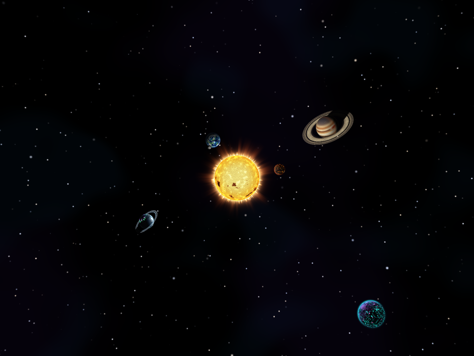
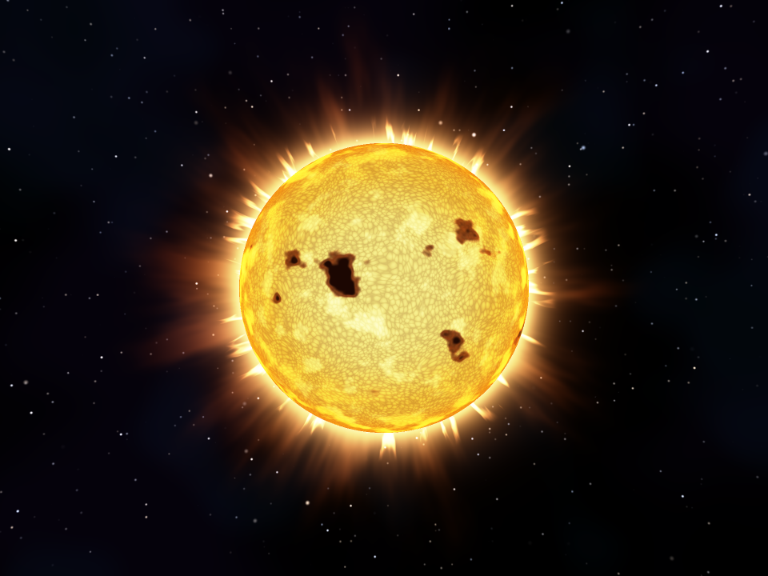
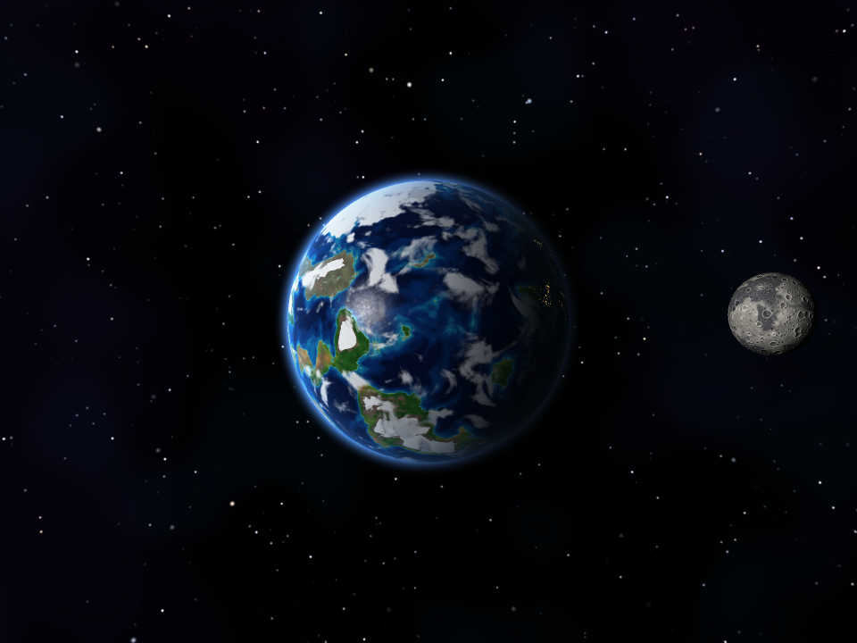
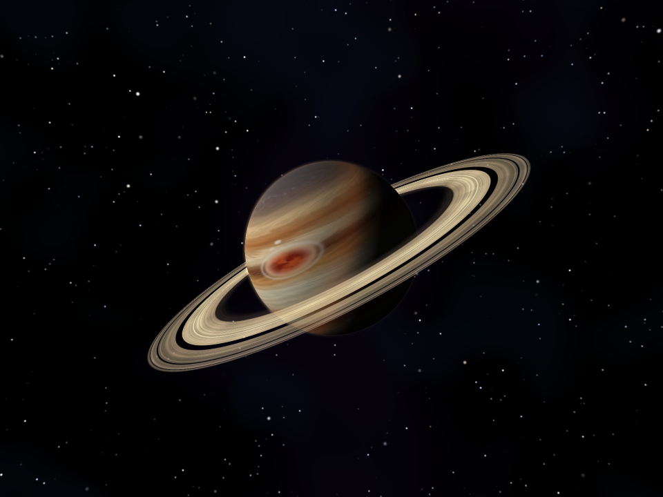
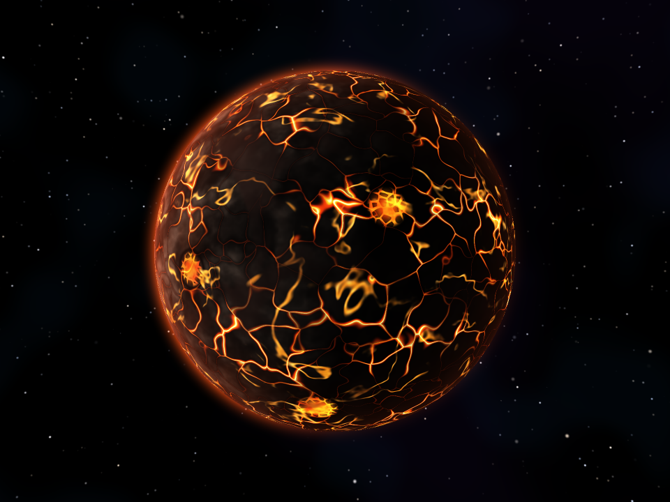
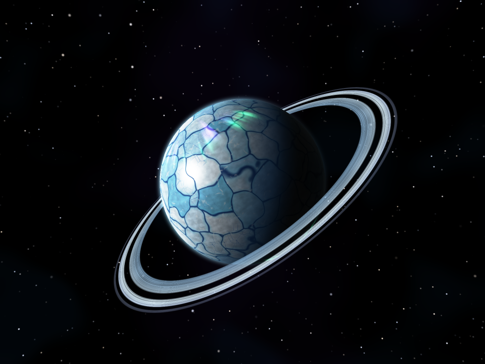
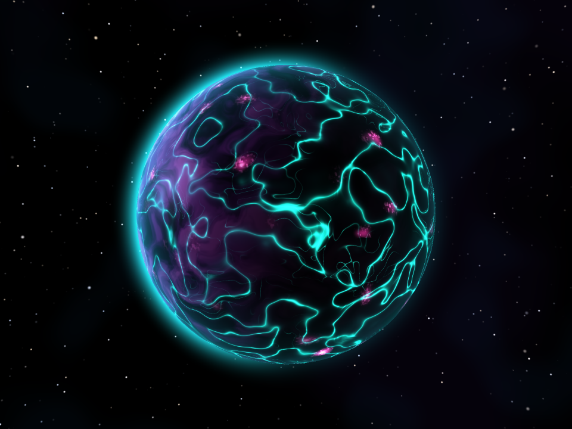

# Laboratorio 5 — Sistema Planetario con Shaders Procedurales

**Gráficas por Computadora (CC2018) · Universidad del Valle de Guatemala**

Un software renderer escrito en Rust dibuja un sistema planetario completo —una estrella, seis
cuerpos, una luna y dos sistemas de anillos— sin una sola textura. Cada color nace de funciones
matemáticas: ruido de gradiente, fbm, voronoi, domain warping, rampas de color, fresnel y modelos
de iluminación. El sistema gira, orbita y se anima en tiempo real.


*Vista de sistema: los seis cuerpos orbitan alrededor de Helios Ardens, que también actúa como luz puntual.*

---

## Cuerpos celestes

| # | Nombre | Tipo | Capas del shader | Modelos separados |
|---|--------|------|------------------|-------------------|
| 1 | **Helios Ardens** | Estrella (emisiva, fuente de luz) | 1. Gradiente núcleo → borde con oscurecimiento del limbo · 2. Granulación convectiva (voronoi animado + fbm de plasma) · 3. Manchas solares con umbra y penumbra · 4. Llamaradas en el limbo (fresnel emisivo pulsante) · Extra: corona exterior con serpentinas y protuberancias | Cáscara de corona |
| 2 | **Terra Viridis** | Planeta rocoso | 1. Océanos con gradiente de profundidad y reflejo especular · 2. Continentes y biomas por altura, latitud y humedad · 3. Casquetes polares y picos nevados con borde ruidoso · 4. Nubes en movimiento con sombra proyectada · Extra: luces de ciudades nocturnas, halo atmosférico azul y eclipses | **Luna Selene** (icosfera propia) |
| — | **Selene** | Luna de Terra Viridis | 1. Variación de albedo del regolito · 2. Maria de basalto · 3. Cráteres por voronoi en dos escalas, con relieve (normal perturbada) · 4. Rayos de eyección de cráteres jóvenes | Órbita inclinada y rotación sincrónica |
| 3 | **Aurelia** | Gigante gaseoso | 1. Bandas latitudinales crema / ocre / óxido / marrón · 2. Turbulencia en los bordes de las bandas (domain warping y vientos zonales) · 3. Gran Tormenta en espiral y óvalos blancos · 4. Oscurecimiento polar, limbo y terminador cálido · Extra: sombra de los anillos sobre el planeta | **Anillos** (annulus propio) |
| 4 | **Ignis** | Planeta volcánico | 1. Corteza de basalto con relieve (fbm + ridged) · 2. Grietas de lava por bordes de voronoi (F2 − F1), emisivas y pulsantes · 3. Ríos de lava y calderas con costra flotante · 4. Ceniza y humo rojizo que deriva | — |
| 5 | **Cristalis** | Mundo de hielo fracturado | 1. Placas de hielo por voronoi con escarcha · 2. Grietas azul profundo, fisuras finas y crestas de presión · 3. Brillo cristalino: especular alto y destellos · 4. Auroras polares verdes y violetas animadas | **Anillos de hielo** (annulus propio) |
| 6 | **Nyx Lumina** | Planeta alienígena bioluminiscente | 1. Base violeta con domain warping · 2. Venas turquesa con pulsos que viajan · 3. Manchas de esporas magenta que respiran · 4. Halo atmosférico cian con fresnel | — |

Las capas aparecen comentadas en el código como `CAPA 1 … CAPA 4` dentro de cada archivo de
[`src/shaders/`](src/shaders/), de modo que cualquier revisor puede contarlas.

---

## Galería

| | |
|---|---|
|  |  |
| **Helios Ardens.** Granulación viva, manchas solares en latitudes medias y una corona con protuberancias. | **Terra Viridis y Selene.** Océanos con reflejo solar, biomas, nubes con sombra, luces de ciudades en el terminador y la luna con cráteres en relieve. |
|  |  |
| **Aurelia.** Bandas turbulentas, Gran Tormenta en espiral y anillos con divisiones tipo Cassini; el planeta proyecta su sombra sobre los anillos. | **Ignis.** Grietas de lava activas y frías, calderas con costra flotante y humo rojizo. |
|  |  |
| **Cristalis.** Placas de hielo, grietas profundas, destellos cristalinos, auroras polares y anillos de hielo finos. | **Nyx Lumina.** Venas bioluminiscentes que pulsan, esporas magenta y un halo cian. |

Todas las capturas salen del propio programa (`--capturas`) con supersampling 2×2.

---

## Controles

| Tecla | Acción |
|-------|--------|
| `1` – `6` | Helios Ardens · Terra Viridis + Selene · Aurelia · Ignis · Cristalis · Nyx Lumina |
| `0` | Sistema completo (traslación de los planetas alrededor del sol) |
| Flechas | Rotar la cámara alrededor del cuerpo |
| `+` / `-` (o rueda del ratón) | Acercar / alejar |
| `P` | Pausar / reanudar la animación |
| `R` | Activar / desactivar la resolución dinámica |
| `S` | Guardar captura a resolución completa en `screenshots/<nombre>.png` |
| `Esc` | Salir |

---

## Compilación y ejecución

Requisitos: [Rust](https://rustup.rs) estable (edición 2021). Cargo descarga las dependencias en la
primera compilación.

```bash
cargo run --release
```

Otros modos:

```bash
cargo run --release -- --capturas          # regenera todas las capturas de screenshots/
cargo run --release -- --capturas aurelia  # solo las vistas cuyo nombre contenga "aurelia"
cargo run --release -- --bench             # mide el tiempo por cuadro de cada vista
cargo run --release -- --generar-esfera    # regenera assets/sphere.obj
```

### Dependencias

| Crate | Uso |
|-------|-----|
| `minifb` | Ventana y presentación: copia un buffer de píxeles `u32` directo a la pantalla, sin texturas. |
| `nalgebra-glm` | Matemática estilo GLM (`vec3`, `mat4`, `look_at`, `perspective`). |
| `rayon` | Rasterización paralela por franjas de pantalla. |
| `flate2`, `crc32fast` | Compresión de las capturas PNG (el programa solo **escribe** imágenes; nunca carga ninguna). |

---

## Arquitectura

```
src/
├── main.rs            Bucle interactivo, controles, capturas y benchmark
├── camera.rs          Cámara orbital (yaw, pitch, distancia)
├── mesh.rs            Generadores: esfera UV (.obj), icosfera de la luna, annulus de los anillos
├── obj.rs             Cargador OBJ (v / vt / vn / f); ignora materiales a propósito
├── pipeline.rs        Vertex shader → ensamblado y culling → rasterización baricéntrica → fragment shader → z-buffer → mezcla
├── framebuffer.rs     Color HDR + profundidad, mapeo tonal, escalado bilineal y supersampling
├── png.rs             Escritor PNG mínimo
├── scene.rs           Cuerpos, rotación, órbitas, luna, anillos, halos y vistas
└── shaders/
    ├── mod.rs         Interfaz uniforme: FragmentIn, ShadeContext y despacho por cuerpo
    ├── utils.rs       Hash, ruido de gradiente y de valor, fbm, ridged, voronoi, warp, rampas, fresnel, sombras
    ├── background.rs  Campo de estrellas y nebulosa procedurales
    ├── halo.rs        Halo atmosférico (cáscara aditiva)
    ├── helios.rs  terra.rs  selene.rs  aurelia.rs  rings.rs  ignis.rs  cristalis.rs  nyx.rs
```

**Pipeline.** El vertex shader lleva cada vértice de objeto a mundo, a clip y a pantalla. El
rasterizador recorre la caja envolvente de cada triángulo con funciones de arista, interpola los
atributos con corrección de perspectiva y ejecuta el fragment shader solo si el fragmento supera
la prueba de profundidad. La pantalla se divide en franjas de 8 filas que `rayon` procesa en
paralelo; cada franja recorre las llamadas de dibujo en el mismo orden, por lo que el resultado
coincide con el de un render secuencial.

**Interfaz de shader.** Cada fragmento recibe `FragmentIn { pos_obj, normal, uv, pos_world, time,
light_dir, view_dir, camera_pos, ctx }`. El ruido se evalúa sobre `pos_obj`, la posición 3D en
espacio de objeto: no existen costuras de UV ni distorsión en los polos, y los rasgos giran con el
planeta. Las UV solo intervienen como dato numérico (el ángulo de los anillos).

**Pasadas de mezcla.** Primero se dibujan los cuerpos opacos, luego los anillos con mezcla alfa
(los huecos se descartan) y al final los halos y la corona con mezcla aditiva sobre una cáscara
esférica de caras traseras.

**Sombras analíticas.** Las sombras no usan mapas: un rayo hacia el sol se prueba contra la esfera
del planeta (sombra sobre los anillos, eclipses entre Terra y Selene) o contra el plano de los
anillos (sombra de los anillos sobre Aurelia y Cristalis).

**Animación.** Cada cuerpo rota sobre un eje inclinado; Selene orbita a Terra con inclinación y
rotación sincrónica; en la vista de sistema los planetas se trasladan alrededor del sol. Los
shaders reciben el tiempo: la granulación solar fluye, las nubes derivan, la lava y las esporas
pulsan, las auroras ondulan y los vientos zonales de Aurelia giran a distinta velocidad según la
latitud. Un esquema de *flow map* con dos capas desfasadas evita que la cizalladura de esos vientos
estire las bandas sin límite.

### Rendimiento

El programa mide el costo de cada vista con `--bench` (960 × 720, resolución completa, CPU de 12
hilos):

| Vista | ms / cuadro | FPS |
|-------|------------:|----:|
| Helios Ardens | 39.9 | 25.0 |
| Terra Viridis + Selene | 37.6 | 26.6 |
| Aurelia | 23.4 | 42.7 |
| Ignis | 77.6 | 12.9 |
| Cristalis | 24.9 | 40.2 |
| Nyx Lumina | 63.9 | 15.6 |
| Sistema completo | 41.4 | 24.1 |

Optimizaciones aplicadas:
- **Caché del fondo:** la nebulosa y las estrellas se recalculan solo cuando la cámara se mueve; cada cuadro anima únicamente el centelleo.
- **Ruido sin ramas:** el hash de una sola ronda y la tabla de gradientes reducen el costo de voronoi y fbm.
- **Resolución dinámica:** mientras hay movimiento, la resolución interna se ajusta entre 50 % y 100 % para sostener unos 30 FPS. Con la escena quieta el cuadro se dibuja a resolución completa, y `S` siempre guarda a resolución completa.

---

## Cumplimiento de la rúbrica

| Criterio | Puntos | Evidencia |
|----------|-------:|-----------|
| Creatividad del diseño | 30 | Siete cuerpos con identidad visual propia: paletas coherentes, un punto focal por cuerpo (Gran Tormenta, calderas, auroras, venas bioluminiscentes), halos atmosféricos, corona solar, eclipses y fondo estelar procedural. |
| Complejidad de shaders (4 capas × 10) | 40 | Cada shader declara al menos cuatro capas que afectan el color (`CAPA 1 … CAPA 4`), descritas en la tabla de cuerpos. |
| Planetas extra (3 × 10) | 30 | Ignis, Cristalis y Nyx Lumina, además de los tres requeridos (estrella, rocoso y gaseoso). |
| Sistema de anillos en un gigante gaseoso | 20 | `rings.rs` + `mesh::annulus`: anillos de Aurelia como modelo separado, con bandas finas, divisiones de Cassini, Encke y Keeler (los fragmentos casi vacíos se descartan), variación de color y sombra del planeta. Cristalis suma un segundo sistema de anillos de hielo. |
| Luna en un planeta rocoso | 20 | `selene.rs` + `mesh::icosphere`: Selene es un modelo propio en órbita inclinada alrededor de Terra Viridis, con cráteres en relieve y eclipses mutuos. |
| Rotación y traslación (opcional) | — | Rotación axial de cada cuerpo, órbita de la luna y traslación de todos los planetas en la vista de sistema (`0`). |

**Restricciones respetadas**
- Cero texturas, imágenes, materiales `.mtl` o bibliotecas de carga de imágenes: todo el color sale de `src/shaders/`.
- Los anillos y la luna usan mallas propias, separadas de `sphere.obj`, con transformación y shader propios.
- `assets/sphere.obj` es la esfera base que carga el cargador OBJ. El programa la generó con `--generar-esfera` porque el archivo de Canvas no estaba disponible; basta con reemplazarla por la del curso.
